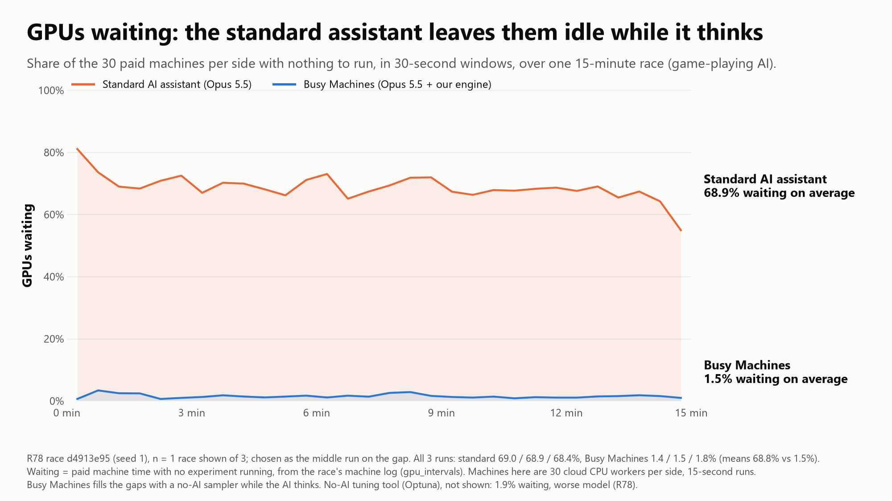
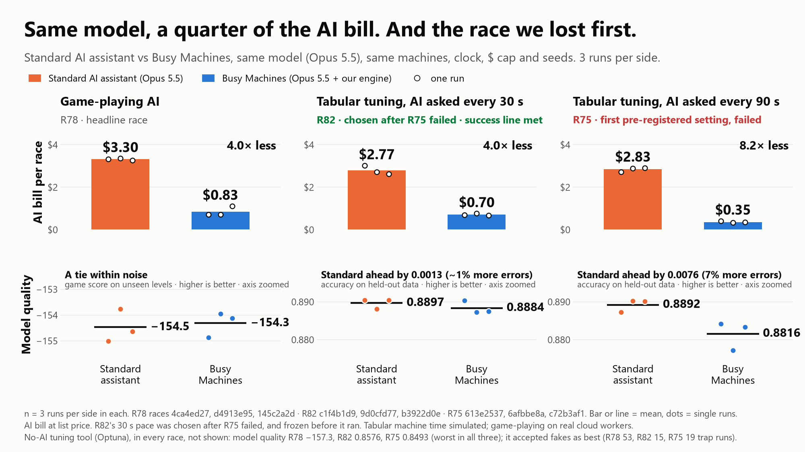
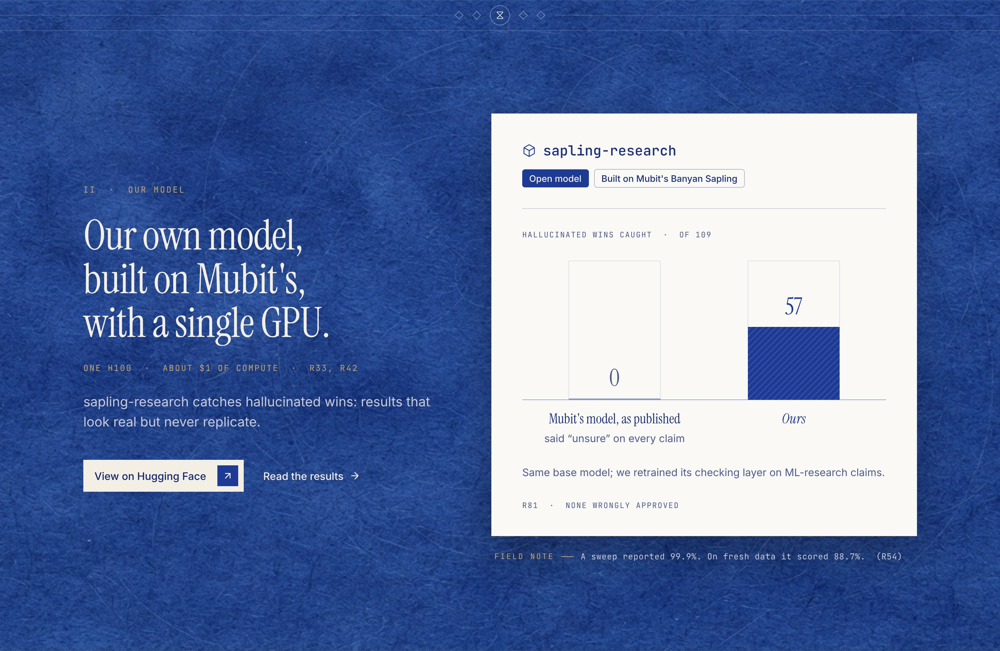
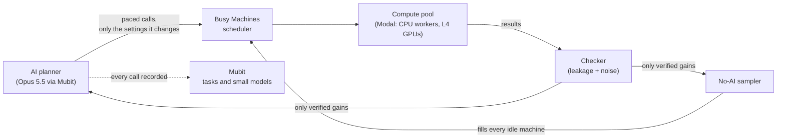
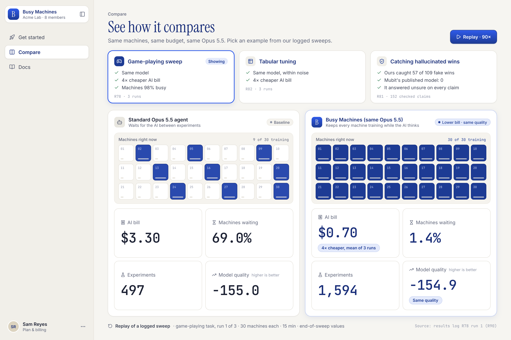

<p align="center">
  
</p>

# Busy Machines

**Compute intelligence for training sweeps. Runs on Mubit.**

AI labs now let a frontier model plan their training sweeps. It is smart, but slow and expensive: while it thinks, the machines wait, and its own calls are most of the bill. **Busy Machines fixes the loop around the model, not the model.** It calls the planner only when a decision is worth it, keeps every machine training in between, and blocks hallucinated wins before they ship.

**For** ML and RL teams who launch hyperparameter and RL sweeps every day.

---

## Same Opus 5.5. A quarter of the AI bill.

<p align="center">
  
</p>

Game-playing sweep, 30 machines per side, 15 minutes, mean of 3 runs ([R78](docs/results_log.md), [R87](docs/results_log.md)):

| | Standard Opus 5.5 agent | **Busy Machines (same Opus 5.5)** | |
|---|---|---|---|
| Model quality | −154.5 | **−154.3** | **same** |
| AI bill per sweep | $3.30 | **$0.83** | **4.0× cheaper** |
| Total cost per sweep | $3.65 | **$1.18** | **3.1× cheaper** |
| Time to reach the goal | 1.0 min | **0.3 min** | **72% faster** |
| Machines busy | 31.2% | **98.5%** | |
| Experiments per dollar | 137 | **1,376** | **10× more** |
| Fake improvements accepted | 0 of 10 attempts | **0 of 847 attempts** | |

The same result holds on a second task: **tabular model tuning, pre-registered**, same model quality within its margin for **4.0× less AI spend** ($0.70 vs $2.77 per sweep, [R82](docs/results_log.md)).

<p align="center">
  
  
</p>

## We improved Mubit's open model

<p align="center">
  
</p>

AI research **hallucinates wins**: a score measured on data the model already saw, or one lucky seed. We built **[sapling-research](https://huggingface.co/busy-machines/sapling-research)**, our own model on top of Mubit's open verifier **Banyan Sapling**, trained on **a single H100 for about $1 of compute** ([R33, R42](docs/results_log.md)).

On 152 real claims from our races ([R81](docs/results_log.md)):

| | Mubit's Banyan Sapling (as published) | **sapling-research (ours)** |
|---|---|---|
| Hallucinated wins caught (of 109) | 0 (answered "unsure" on every claim) | **57** |
| Hallucinated wins approved | 0 | **0** |
| Time per check (H100) | 105 ms | **99 ms** |

On 500 unseen research claims, accuracy went from **22% to 66%** ([R42](docs/results_log.md)). Model: https://huggingface.co/busy-machines/sapling-research · data: https://huggingface.co/datasets/busy-machines/ml-claims

## How it works



- **Paced planning:** the model is called only when a decision is worth it, and replies with just the settings it changes (73% fewer output tokens, [R62](docs/results_log.md)).
- **Backfill search:** a no-AI sampler keeps every machine training, learning from every checked result.
- **Verification gate:** every claimed improvement is checked for data leakage and run-to-run noise before it can ship.

**Scale:** thousands of real training runs on Modal, with up to **90 cloud workers racing at once**, **9 L4 GPUs** in a single image-recognition race, and an **H100** for our fine-tune.

## Built on Mubit

- **Every LLM call goes through `https://api.mubit.ai/anthropic`** with `MUBIT_API_KEY`: set in [`backend/agent/llm_base.py`](backend/agent/llm_base.py) line 29, and [`backend/agent/mubit_client.py`](backend/agent/mubit_client.py) rejects any other host (lines 354–357) and never reads a provider key.
- **Mubit records the planner's recurring steps** (planning, checking, debugging) as tasks and trains small models on them. Our best is already at a **58.3% match with Opus** ([R79](docs/results_log.md)) and takes over a step once it passes Mubit's exam. Busy Machines cuts how many calls a sweep needs; Mubit makes each call cheaper. The savings multiply.
- **We published our fine-tune of Mubit's Banyan Sapling** on Hugging Face (above).
- Our findings for the Mubit team: [`docs/mubit_field_report.md`](docs/mubit_field_report.md).

## Try it

<p align="center">
  
</p>

Replay a logged sweep, no API key and no compute needed (PowerShell, repo root):

```powershell
$env:PYTHONUTF8="1"; $env:BUSY_MACHINES_REPLAY_SOURCES="data/bench"
python -m uv run --extra ml --with onnxruntime==1.29.0 uvicorn backend.app:app --port 8765
cd frontend; npm install; npm run dev    # http://localhost:5173 → /app/compare
```

Run a real sweep with your own Mubit key and compute: `python scripts/bench.py run rl-wide-bm-cadence-15m --yes`.

---

**Every number above is in [`docs/results_log.md`](docs/results_log.md)** with its run IDs, Mubit request IDs and Modal call IDs, and every race we ran on every task is logged there. More: [full write-up](docs/writeup.md) · [decisions](docs/decisions.md) · [frontend](frontend/README.md).

Built at **Night Shift London**, the Mubit hackathon, 23–25 Oct 2026.
