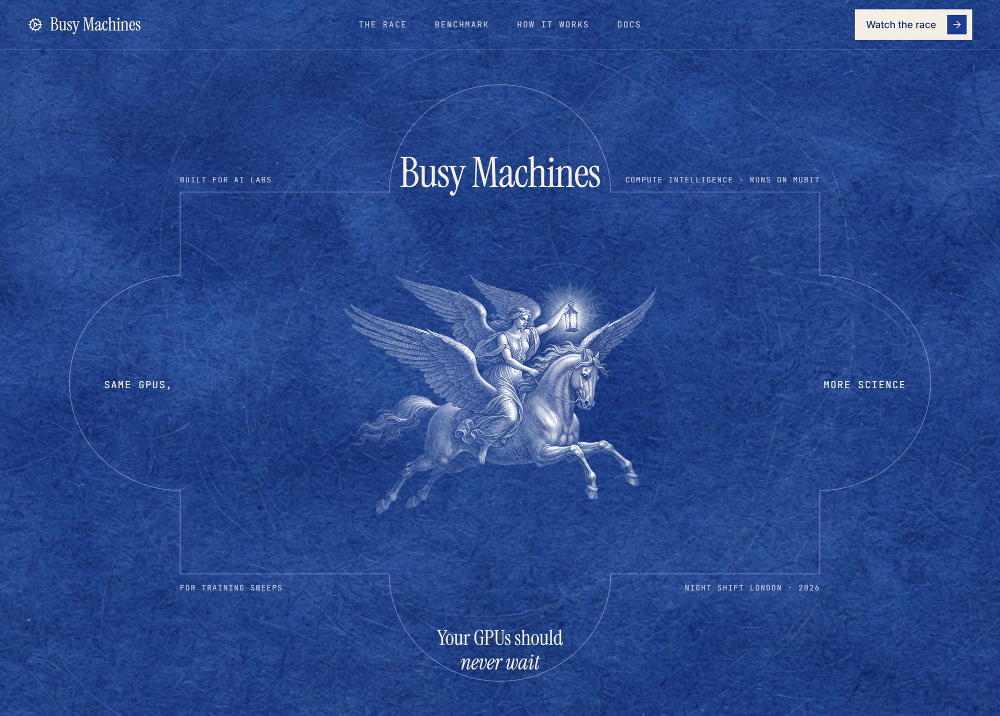
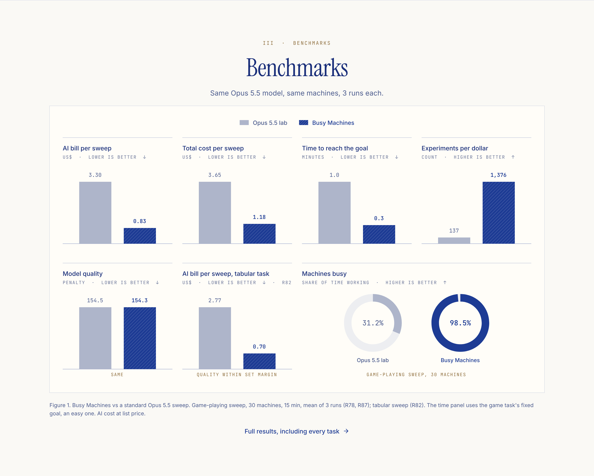
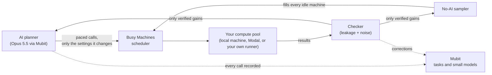

<p align="center">
  
</p>

# Busy Machines

<h1>Compute intelligence for training sweeps. Runs on Mubit.</h1>

AI labs now let a frontier model plan their training sweeps: it reads the results so far, picks the next settings to try, and decides which result is the new best. The model is smart, but it is slow and expensive. While it thinks, the machines wait, and its own calls become most of the bill. Across the standard Opus 5.5 sweeps we measured, **90.6% of the money went to the AI, not to compute** ([R54](docs/results_log.md)).

**Busy Machines fixes the loop around the model, not the model.** It calls the planner only when a decision is worth it, keeps every machine training in between, and checks every claimed improvement before it can ship. You keep your planner (Opus 5.5 here), your training code and your compute. The same sweep then costs a quarter of the AI bill for the same model quality.

**Who it is for:** any team that launches training sweeps every day. That means AI labs (research, RL and post-training, evals) first, and then every company that retrains its own models on a schedule.

---

## What we benchmarked

**`night/bench`**, our benchmark, races AI-planned training sweeps on real tasks from public task families, costed in AI and compute dollars. It follows the fixed-budget method of METR's RE-Bench. Every task has two extra parts. One is a **held-out score** that the planner never sees, which is the only score we report as model quality. The other is a **planted shortcut**, a setting that inflates the reported score without making the model better. It tests whether fake improvements get through.

| Task | What is trained | Public source | Compute per side | Model quality = |
|---|---|---|---|---|
| **Game-playing (RL)** | A PPO controller that learns to swing up a pendulum whose physics change between levels | Pendulum-v1 (Gym / gymnax equations) | 30 Modal cloud CPU workers, 15 s runs | Return on unseen physics levels |
| **Tabular model tuning** | Neural nets on an OpenML tabular classification task (task 167168) | LCBench (Zimmer, Lindauer, Hutter 2021), served by the YAHPO Gym surrogate of real training curves | 16 simulated L4 GPUs | Balanced accuracy on the test split |
| **Image recognition** | A fast CNN on CIFAR-10, in the style of the airbench speedrun | CIFAR-10 speedrun (airbench) | 3 L4 GPUs on Modal | Accuracy on a held-out half of the CIFAR-10 test set |

The repo also includes a fourth task that we haven't raced yet: a nanoGPT-style language model on tiny-shakespeare.

**Three sides in every race**, with the same machines, the same 15 minutes, the same seeds and the same starting code:

1. a **standard Opus 5.5 agent** (Opus plans every step);
2. **Busy Machines** with the same Opus 5.5;
3. **Optuna**, a no-AI search baseline.

Each headline result is the mean of 3 runs. Every LLM call on both AI sides goes through Mubit.

**For our verifier model** we used three test sets:

- **500 held-out research claims**: accuracy 22% → 66% ([R42](docs/results_log.md)).
- **152 real claims from our races**, with known ground truth ([R81](docs/results_log.md)).
- **400 ContractNLI cases**, Banyan Sapling's original contract domain: 77.3% → 84.3%. It got better on its original domain too, rather than worse ([R42](docs/results_log.md)).

## The result in one table

Same planner (Opus 5.5 through Mubit), same 30 machines per side, same 15 minutes, same seeds and starting code. Only the loop around the planner differs. Game-playing (RL) sweep, mean of 3 runs ([R78](docs/results_log.md), [R87](docs/results_log.md)):

| | Standard Opus 5.5 agent | **Busy Machines (same Opus 5.5)** | |
|---|---|---|---|
| Model quality (score on unseen levels, higher is better) | −154.5 | **−154.3** | **same** |
| AI bill per sweep | $3.30 | **$0.83** | **4.0× cheaper** |
| Total cost per sweep (AI + compute) | $3.65 | **$1.18** | **3.1× cheaper** |
| Time to reach the goal | 1.0 min | **0.3 min** | **72% faster** |
| Cost to reach the goal | $0.20 | **$0.022** | **89% cheaper** |
| Machines busy | 31.2% | **98.5%** | |
| Experiments run | 500 | **1,587** | **3.2× more** |
| Experiments per dollar | 137 | **1,376** | **10× more** |
| Fake improvements accepted | 0 of 10 attempts | **0 of 847 attempts** | |

<p align="center">
  
</p>

**A second task, pre-registered.** On tabular model tuning we wrote the success line down before the race and then met it ([R82](docs/results_log.md)). Model quality matched within the pre-registered margin (0.8884 vs 0.8897), for **4.0× less AI spend** ($0.70 vs $2.77 per sweep), **35% less in total** (compute time simulated on this task), with machines waiting **1.1% vs 30.3%** of the time.

**Where it pays most.** The gain is largest on sweeps made of many short runs, where the planner's thinking time is long compared with each run. That covers RL sweeps, tabular and small-model tuning, and early-stage search. On long GPU runs the planner's pauses matter less. On image recognition with real L4 GPUs, the AI bill still fell **4.5×**, but there the standard agent's model was slightly better ([R85](docs/results_log.md)). Busy Machines' pacing is a setting, so a long-run sweep can call the planner more often.

**Why not drop the AI altogether?** We ran a no-AI baseline (Optuna) in every race. It is the cheapest, but it finds worse models and believes its own fakes. In the races above it accepted 53 fake improvements out of 4,648 attempts. Across 9 races, the model it shipped was a fake in 6 ([R54](docs/results_log.md), [R78](docs/results_log.md)). On image recognition, one of its shipped models reported **99.94%** accuracy but scored **88.7%** on data it had never seen. Busy Machines keeps the AI for the decisions that need judgement and uses cheap search for everything else.

---

## The problems we set out to solve

The founder of Mubit has written publicly about the problems that matter for agents that run real work. We built Busy Machines to answer them one by one, with a measurement for each.

**1. "Agents should wait less and do more."** A planning agent spends most of a sweep thinking, and everything waits for it.
→ Busy Machines paces the planner, asks it only for the settings it wants to change (**73% fewer output tokens**, [R62](docs/results_log.md)), and fills every idle machine with a no-AI sampler that learns from every checked result. Machines waiting fell from **68.8% to 1.5%** ([R78](docs/results_log.md)).

**2. Parallelism and cloud agents should give a full utilisation cycle.** Today, adding machines to an AI-planned sweep mostly adds machines that wait.
→ The scheduler treats the machines as one pool. Whenever a slot is free, it gets work, from the planner if a proposal is ready and from the sampler if not. Our races ran three sides at once on Modal: **30 cloud workers per side (90 in total)** for game-playing, **3 L4 GPUs per side (9 in total)** for image recognition, plus an **H100** for our model fine-tune.

**3. After the shiny parts, only cost and efficiency matter.**
→ Every number we report is a cost or an efficiency, measured on real sweeps: AI bill per sweep, total cost per sweep, cost and time to reach the goal, and experiments per dollar. Busy Machines makes fewer AI calls count, and Mubit makes each call cheaper. The two savings multiply.

**4. A verifier must not share context with the agent it checks**, or it inherits the agent's bias.
→ The checker never sees the planner's reasoning. It sees only the claim and the evidence: the result, the held-out score, and the spread across repeat runs. It looks for data leakage (a score measured on data the model has already seen) and for luck (a gain smaller than run-to-run noise). In the headline race it accepted **0 of 847** fake improvements. We also trained an independent verifier model for this (next section).

**5. Managing a farm of models that keep evolving, at low latency, is herculean.**
→ We froze our planning, checking and debugging prompts early, so Mubit groups each of them into one clean, recurring task and can train a small model for it. Every call, check and correction is stored with its Mubit request ID, so any decision can be traced back to the exact call that made it. Our verifier answers in **99 ms** per check on an H100 ([R81](docs/results_log.md)).

**6. Time to visibility: value should show on day one, not after weeks.**
→ The savings come from the loop, so they show up on the **first sweep**, before any small model is trained. Every number above was measured with Opus 5.5 answering every call. A live dashboard shows the AI bill, machines busy, model quality and fakes caught while the sweep runs.

**7. "Won't agents just repeat the same tasks?"**
→ The sweeps never repeat: every lab, model and dataset is different. The steps inside them repeat thousands of times a night: plan the next settings, check a claimed best, explain a failed run. Those recurring steps are what Mubit learns, and they power work that is new every time.

---

## We improved Mubit's open model

AI research **hallucinates wins**: a score measured on data the model already saw, or one lucky run. Mubit released **Banyan Sapling**, an open model that checks whether a claim is supported by its evidence. We fine-tuned it for AI-research claims and published the result as **[sapling-research](https://huggingface.co/busy-machines/sapling-research)**. It was trained on **a single H100 for about $1 of compute** ([R33, R42](docs/results_log.md)). Our training data is public: [busy-machines/ml-claims](https://huggingface.co/datasets/busy-machines/ml-claims).

On 152 real claims taken from our own races ([R81](docs/results_log.md)):

| | Mubit's Banyan Sapling (as published) | **sapling-research (ours)** |
|---|---|---|
| Hallucinated wins caught (of 109) | 0 (answered "unsure" on every claim) | **57** |
| Hallucinated wins approved | 0 | **0** |
| Time per check (H100) | 105 ms | **99 ms** |

On 500 research claims it had never seen, accuracy rose from **22% to 66%** ([R42](docs/results_log.md)). The model is small, open and fast, so a lab can run it next to every sweep, on its own hardware, without sending results anywhere.

---

## How it works



1. **Paced planning.** The planner is called when a decision is worth it: on a schedule you set, or when a result needs judgement. It replies with a short, structured list of the settings it wants to change. Prompts are frozen and stateless, laid out so that the provider's prompt cache and Mubit's task grouping both work.
2. **Backfill search.** Between planner calls, a no-AI sampler keeps every free slot training and learns from the checked results. In all 3 headline runs, the shipped model came from settings it found between planner calls ([R84](docs/results_log.md)).
3. **Verification gate.** A claimed new best must pass the leakage check and the noise check before it becomes the best, and only the best can ship.
4. **Corrections feed the next model.** When a person or the checker marks a result as wrong, the correction is stored against the experiment and its exact Mubit request ID (`POST /api/experiments/{id}/flag`), and the same request is rated "Bad" in the Mubit console. Mubit trains a new small-model version for a task from its recorded calls, grades each version against the provider's answers, and serves a step only once that version passes its exam. Our best small model so far is at a **58.3% match with Opus** ([R79](docs/results_log.md)).
5. **Everything is traceable.** Every experiment is stored with its config, seed, Mubit request ID and compute call ID, and can be exported as JSONL (`GET /api/races/{id}/export.jsonl`).

---

## Integrate it your way

Busy Machines is a layer, so a team can adopt as much of it as it wants:

- **Compute: any pool you like.** A small `Runner` interface ([`workers/runners/base.py`](workers/runners/base.py)) has three methods: list the slots, launch a run, wait for its result. It ships with a **local** runner (your own machine or workstation), a **Modal** runner (cloud GPUs and CPUs, billed per second) and a **simulated** runner (plan a sweep for $0 before spending compute). Slurm, Kubernetes or Ray is one more class implementing the same interface. You set your own price per machine-hour, so the cost report matches your bill.
- **Your planner stays.** Our planner client calls Mubit's Anthropic endpoint, so any Claude model works today. Mubit also routes OpenAI, Gemini and open models with the same one-URL change, and Claude Code and Codex run through the same gateway.
- **Your training code.** A task is a plain Python module with a settings space and a train function that returns a held-out score ([`workers/targets/base.py`](workers/targets/base.py)). We ship game-playing (RL), tabular tuning, image recognition and language-model examples.
- **API, CLI or dashboard.** You can start and watch sweeps over REST and WebSocket (`POST /api/races`, `/ws/races/{id}`), from the command line (`scripts/bench.py`), or in the web app.
- **Just the verifier.** `sapling-research` runs on its own, on any GPU or CPU, as a check before a result reaches a paper, a leaderboard or a launch.
- **Data control.** Each step sets its own Mubit recording level (`full`, `metadata` or `off`), so a lab's architectures and data never have to be stored.

## Who buys it

Every organisation that trains models on a schedule pays the same two bills, AI and compute, and has the same risk of a fake win. That makes the market very broad:

- **AI labs:** research sweeps, RL and post-training runs, and eval teams that must catch contaminated results before launch. This is where we start.
- **Banks, fintech and insurers:** credit-risk, fraud and pricing models that are retuned constantly and must be checked carefully before they go live.
- **Quant and trading firms:** large daily searches over models and settings, where a fake backtest gain is expensive.
- **Pharma and biotech:** property-prediction and screening models retrained on every new batch of lab data.
- **Recommendation, ads and search teams:** ranking models tuned every week on fresh data.
- **Robotics, autonomous driving and games:** RL in simulation, made of many short runs on CPU and GPU pools, which is exactly the setting of our headline race.

It sells next to Mubit: Mubit makes each AI call cheaper, Busy Machines makes fewer calls count and keeps the compute busy, and both bill on usage.

---

## Built on Mubit

- **Every LLM call goes through `https://api.mubit.ai/anthropic`** with `MUBIT_API_KEY`. This is set in [`backend/agent/llm_base.py`](backend/agent/llm_base.py) (line 29). [`backend/agent/mubit_client.py`](backend/agent/mubit_client.py) rejects any other host (lines 354–357) and never reads a provider key.
- **Mubit records the planner's recurring steps** (planning, checking, debugging) as tasks and trains small models on them. A small model takes over a step once it passes Mubit's exam.
- **We built on all three of Mubit's launches:** the platform (the gateway and tasks), Banyan Sapling (our published fine-tune), and latte/bench. latte/bench measures whether an agent learns from notes. Our benchmark measures what a sweep costs, in AI and compute dollars, to reach a result on real training tasks.
- **Our findings for the Mubit team** are in [`docs/mubit_field_report.md`](docs/mubit_field_report.md).

## Try it

Replay a logged sweep with no API key and no compute (PowerShell, repo root):

```powershell
$env:PYTHONUTF8="1"; $env:BUSY_MACHINES_REPLAY_SOURCES="data/bench"
python -m uv run --extra ml --with onnxruntime==1.29.0 uvicorn backend.app:app --port 8765
cd frontend; npm install; npm run dev    # http://localhost:5173 → /app/compare
```

To run a real sweep with your own Mubit key and compute: `python scripts/bench.py run rl-wide-bm-cadence-15m --yes`.

---

**Every number above is in [`docs/results_log.md`](docs/results_log.md)** with its run IDs, Mubit request IDs and Modal call IDs. Every race we ran on every task is logged there, including the ones that went the other way. More: [full write-up](docs/writeup.md) · [decisions](docs/decisions.md) · [frontend](frontend/README.md).

Built at **Night Shift London**, the Mubit hackathon, 23–25 Oct 2026.
